


<!-- Selos (shields.io): o nome depois de logo= é o ícone do simpleicons.org; a cor vem logo antes de ?style -->

## Sobre mim

<!-- Ícones de linha (Lucide, licença ISC) em assets/icones/sobre/ -->
 **Autônomo:** sites, landing pages e plataformas web sob medida, do levantamento de requisitos à publicação.

 **Estagiário de back-office na Ramo (BH):** SAP Business One, procedures em SQLScript (HANA), consultas em SQL e automação do sistema.

 **Análise e Desenvolvimento de Sistemas na PUC Minas**, com conclusão prevista para jul/2027. Destaque de projeto no 1º semestre (Estúdio de Ideias) e no 2º (Save Money, Destaque do Eixo 2).

 **Alura:** carreira Desenvolvimento Back-End .NET, em andamento.

 Projetos em equipe na faculdade e no hackathon da Ramo, onde representei o grupo junto à organização.

 Os estudos de caso completos estão no [portfólio](https://maicontheodoro-dev.vercel.app).

## Tecnologias

<!-- Ícones (skillicons.dev): cada nome em ?i= vira um ícone, na ordem escrita -->

**Front-end**

**Back-end e APIs**

**Dados**

**Bancos corporativos e ERP**

<!-- Ícones próprios em assets/icones/, no mesmo estilo do skillicons.dev -->
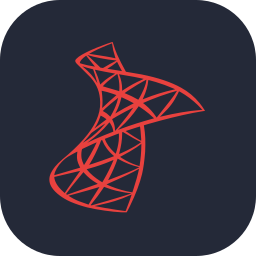 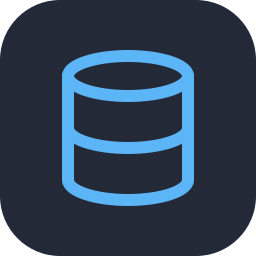 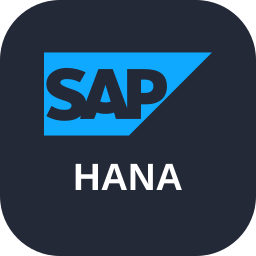 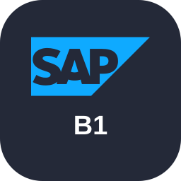

SQL Server · SQL e SQLScript (SAP HANA) · ERP SAP Business One

**Ferramentas e infraestrutura**

Também: Render · Playwright, Vitest e xUnit nos testes automatizados

## Projetos

<!-- Cada card é um print do projeto (assets/projetos/). Só tem link quando o site ou o código estão abertos. -->

### No ar

<table>
  <tr>
    <td width="50%" valign="top">
       
      <b>Ramo Ops</b> · plataforma do 1º Hackathon da Ramo 
      React · TypeScript · Django REST · PostgreSQL · <a href="https://ramoops.vercel.app">site</a>
    </td>
    <td width="50%" valign="top">
       
      <b>Giulia Faraj Advocacia</b> · site institucional para cliente 
      React 19 · Tailwind CSS 4 · GSAP · Lenis · <a href="https://giulia-faraj-adv.vercel.app">site</a>
    </td>
  </tr>
  <tr>
    <td width="50%" valign="top">
       
      <b>MyOrbita</b> · agregador de vagas atualizado todo dia por scrapers 
      Python · GitHub Actions · Firebase · React 19 · <a href="https://github.com/MaiconVts/MyOrbita">código</a> · <a href="https://my-orbita.vercel.app">site</a>
    </td>
    <td width="50%" valign="top">
       
      <b>LeveMente</b> · bem-estar e saúde mental, projeto em equipe da PUC Minas 
      C# (.NET 10) · ASP.NET Core · MongoDB Atlas · Next.js · <a href="https://levemente-web.onrender.com/">site</a> · código privado
    </td>
  </tr>
  <tr>
    <td width="50%" valign="top">
      <a href="https://sidekick-theta-ten.vercel.app">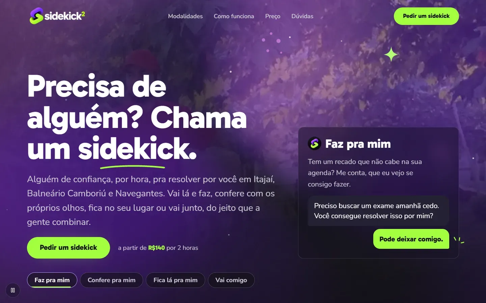</a> 
      <b>Sidekick²</b> · landing de serviço sob demanda, feita para uma startup 
      Next.js 16 · React 19 · TypeScript · Tailwind 4 · GSAP · <b>concluído</b>, projeto não continuado · <a href="https://sidekick-theta-ten.vercel.app">site</a>
    </td>
    <td width="50%" valign="top">
      <a href="https://williamdsilva.vercel.app">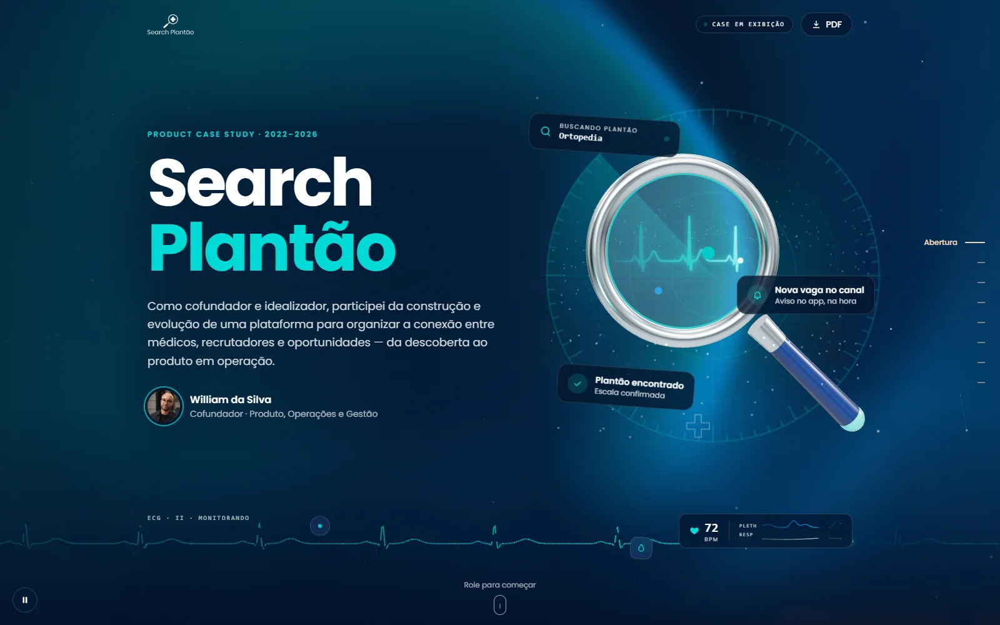</a> 
      <b>Search Plantão</b> · case de produto de startup, página única animada com lupa 3D 
      Next.js · React · TypeScript · Tailwind · GSAP · Three.js · <a href="https://williamdsilva.vercel.app">site</a>
    </td>
  </tr>
  <tr>
    <td width="50%" valign="top">
      <a href="https://jamcomunicacao.vercel.app">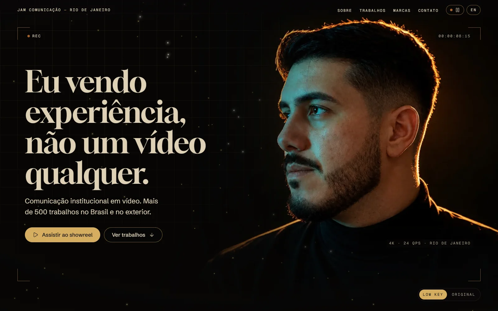</a> 
      <b>Jam Comunicação</b> · portfólio em vídeo de comunicador institucional, em PT e EN, com showreel 
      Next.js · React · TypeScript · next-intl · Cloudflare Workers · <a href="https://jamcomunicacao.vercel.app">site</a>
    </td>
    <td width="50%" valign="top">
      <a href="https://maiconvts.github.io/estudio-de-ideias/">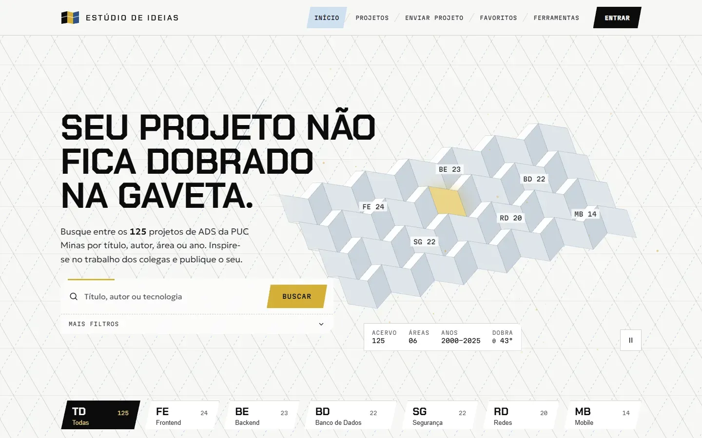</a> 
      <b>Estúdio de Ideias</b> · destaque de projeto do 1º semestre, já redesenhado 
      HTML · CSS · JavaScript · GSAP · Lenis · <a href="https://maiconvts.github.io/estudio-de-ideias/">site</a>
    </td>
  </tr>
  <tr>
    <td width="50%" valign="top">
      <a href="https://vhs-horror.vercel.app">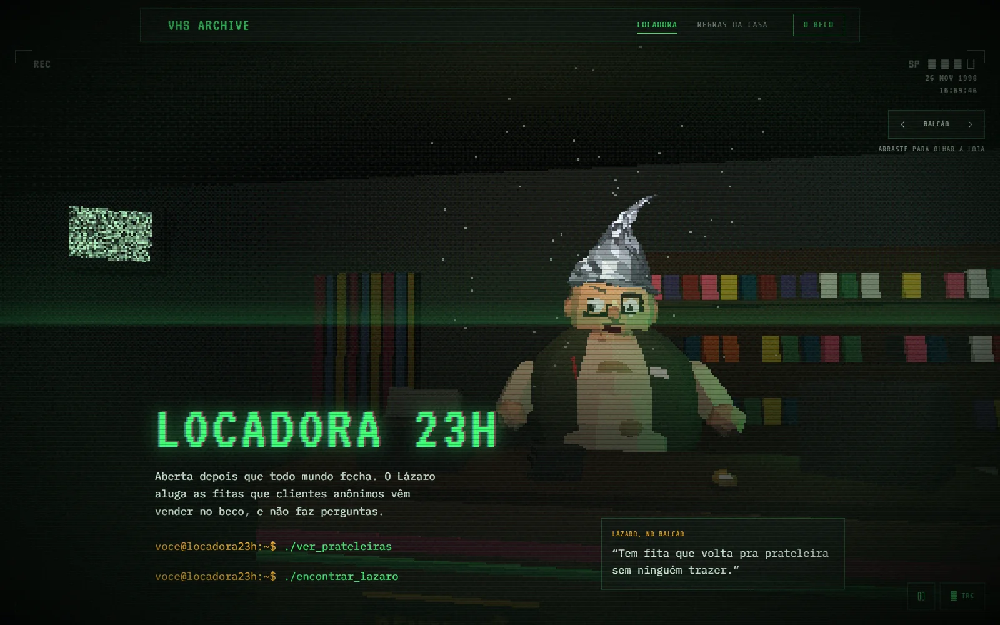</a> 
      <b>VHS Horror Archive</b> · locadora 3D de terror em estética PS1, onde a comunidade escreve e lê fitas 
      Next.js · Three.js · Tailwind · Firebase · <b>no ar, em evolução</b> · <a href="https://vhs-horror.vercel.app">site</a>
    </td>
    <td width="50%" valign="top">
       
      <b>OFinance</b> · controle financeiro familiar, com vários perfis e painel consolidado 
      Next.js · TypeScript · Supabase · Tailwind · <b>em produção e fase de testes</b> · dados de demonstração, código privado
    </td>
  </tr>
</table>

### Em refatoração e em desenvolvimento

Projetos que estou reescrevendo ou construindo agora. O código é privado.

<table>
  <tr>
    <td width="50%" valign="top">
       
      <b>Save Money</b> · gestão financeira pessoal e empresarial, <b>Destaque do Eixo 2 no 2º semestre</b> 
      .NET 8 · ASP.NET Core MVC · EF Core · SQL Server · em equipe · <b>em refatoração</b>
    </td>
    <td width="50%" valign="top">
      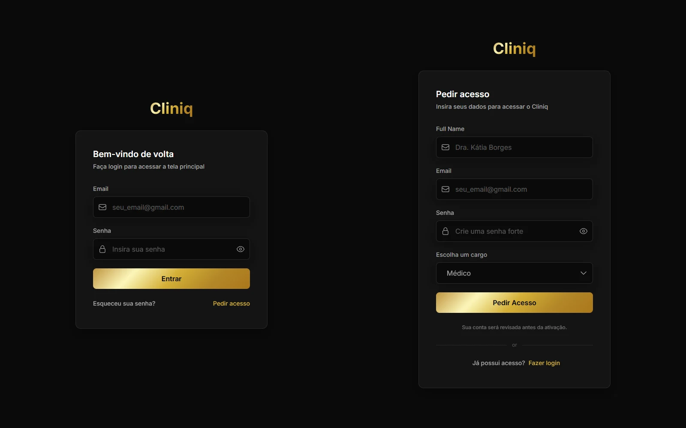 
      <b>Cliniq</b> · gestão para clínicas, com a odontológica como caso-base 
      HTML · Tailwind 4 · JavaScript · Figma · back-end em Python (FastAPI) planejado · <b>em desenvolvimento</b>
    </td>
  </tr>
  <tr>
    <td width="50%" valign="top">
      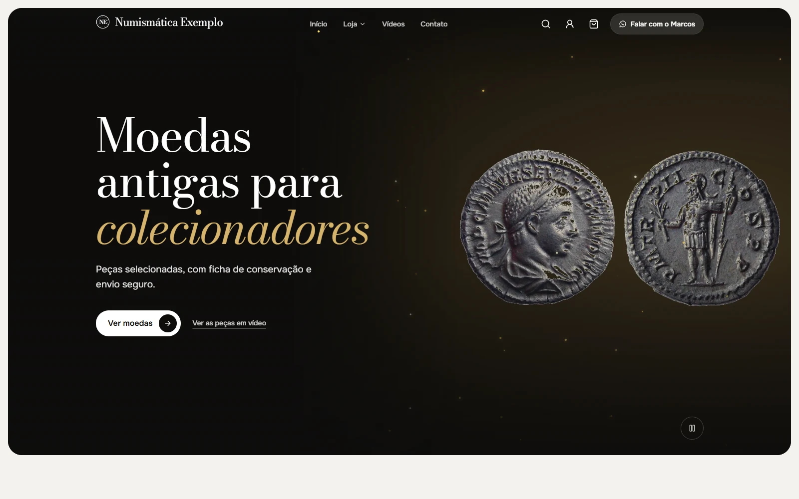 
      <b>E-commerce de numismática</b> · loja de moedas antigas para colecionadores 
      Next.js 16 · React 19 · TypeScript · Tailwind 4 · Firestore · Cloudinary · GSAP · marca de demonstração · <b>em desenvolvimento</b>
    </td>
    <td width="50%" valign="top">
      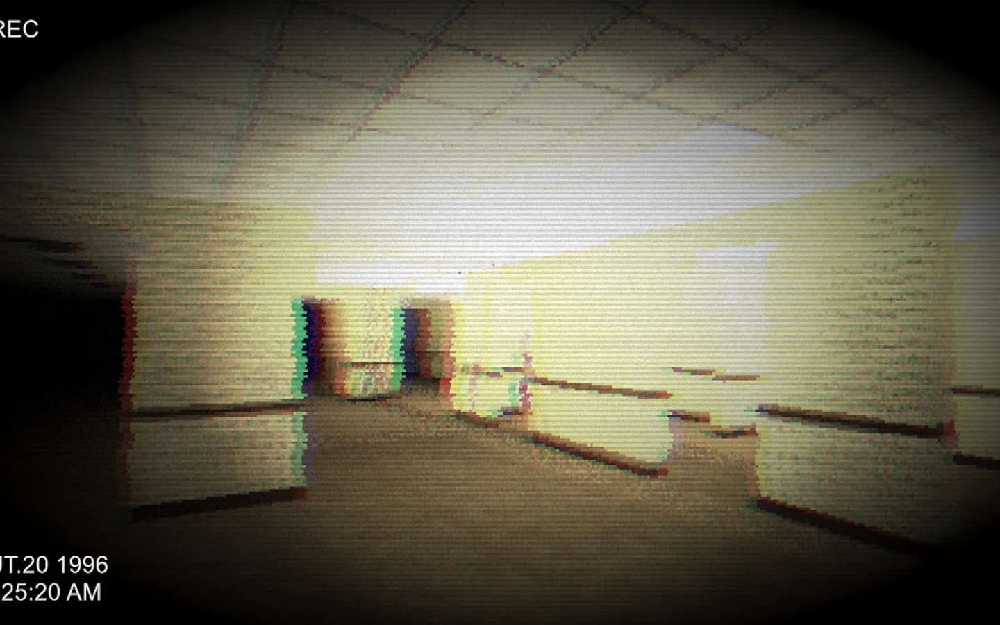 
      <b>VHS Backroom</b> · terror cooperativo para 4 jogadores, com visual de fita VHS 
      Unity 6 · URP · C# · <b>em refatoração</b>
    </td>
  </tr>
  <tr>
    <td width="50%" valign="top">
      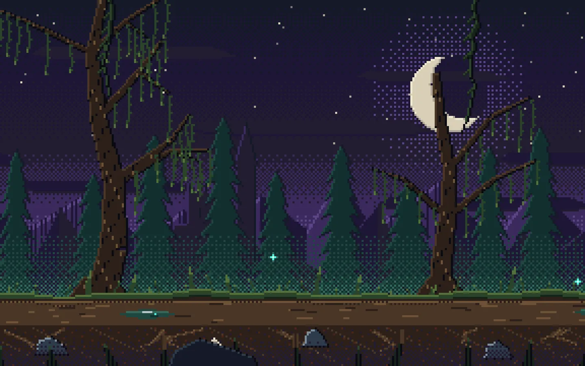 
      <b>RPG incremental</b> · RPG idle em pixel art 
      Pixel art · arte do cenário · <b>em pré-produção</b>
    </td>
    <td width="50%" valign="top"></td>
  </tr>
</table>

### Projetos futuros

Já começados, ainda sem tela para mostrar. Vão ganhar card quando tiverem.

- **Vitrine de Imóveis** · portal imobiliário sob medida, com painel admin de imóveis e corretores · C# · ASP.NET Core 9 MVC · EF Core 9 · PostgreSQL · Identity · Bootstrap
- **Cifrário** · repertório e setlists para músicos, com cifras em ChordPro, na web e no celular
- **Estúdio de Ballet** · site para uma escola de ballet
- **Aperture** · rede social de nicho para fotógrafos, protótipo pronto · React · Tailwind
- **Backoffice de loja** · painel administrativo de produtos, pedidos e clientes · HTML · Bootstrap · JavaScript
- **PokéAPI Explorer** · app de Pokémon com back-end em Flask, do livro *O Programador Autodidata*, escrito sem IA · Python · Flask · React
- **Pragma (FocusGuard)** · suíte de foco com Kanban, Pomodoro, agenda e notas · C# · .NET
- **Project Geometry Idle** · jogo idle de geometria, meu primeiro jogo na Unity · Unity · C#

Mais projetos e estudos de caso no [portfólio](https://maicontheodoro-dev.vercel.app).

---

   Fato curioso: larguei um curso de TI depois de um ano para recomeçar do zero o mesmo curso em uma nova faculdade.

