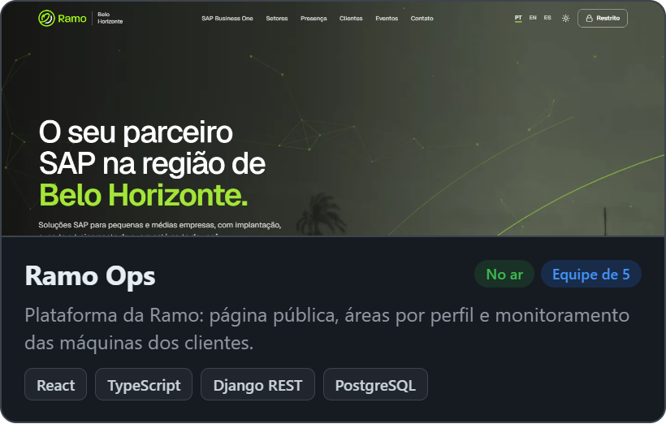
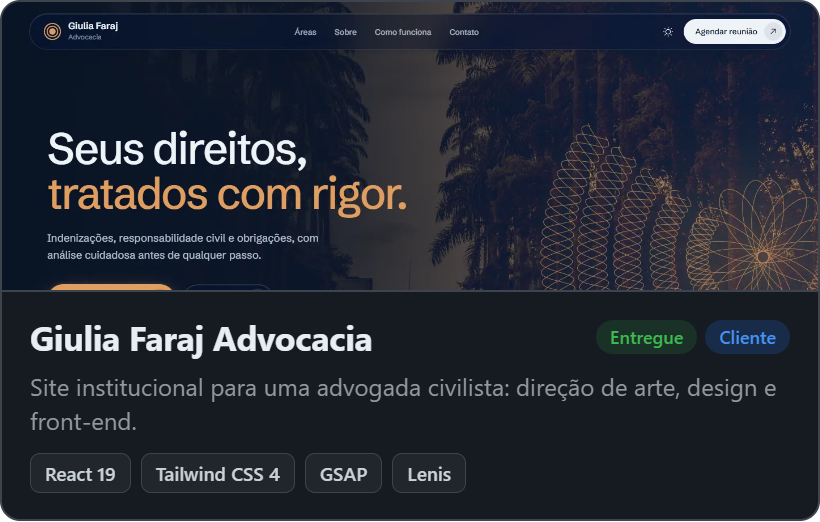
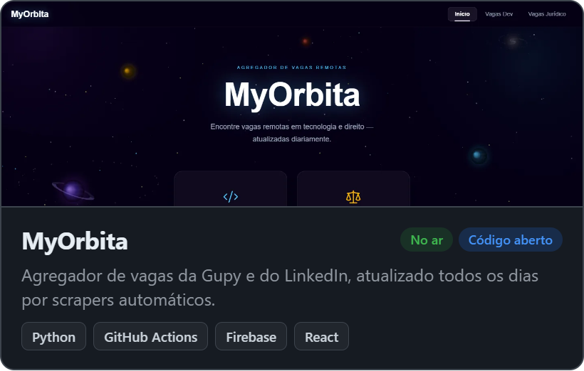
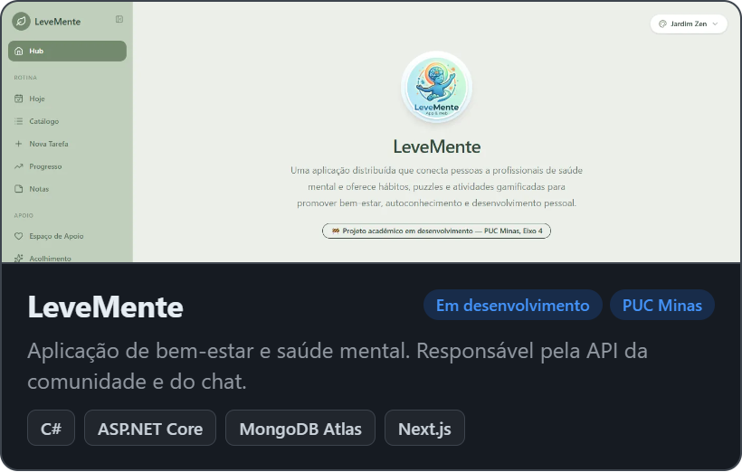

# Maicon Theodoro

Desenvolvedor de software · Vespasiano, MG

<!-- Selos (shields.io): o nome depois de logo= é o ícone do simpleicons.org; a cor vem logo antes de ?style -->

[%2098315--8832-25D366?style=for-the-badge&logo=whatsapp&logoColor=white)](https://wa.me/5531983158832)

## Sobre mim

- 🎓 Curso Análise e Desenvolvimento de Sistemas na PUC Minas.
- 💼 Trabalho como desenvolvedor autônomo, criando sites e sistemas web para clientes.
- 🗄️ No trabalho, escrevo SQL no SAP HANA (HANA Studio) e no SAP Business One.
- 🤝 Já desenvolvi em equipe na faculdade e no hackathon interno da Ramo.
- 🌐 Os estudos de caso completos estão no meu [portfólio](https://maicontheodoro-dev.vercel.app).

## Tecnologias

<!-- Ícones (skillicons.dev): cada nome em ?i= vira um ícone, na ordem escrita -->

**Back-end e APIs**

<!-- dotnet = .NET · cs = C# · py = Python · django = Django · flask = Flask · nodejs = Node.js -->

**Front-end**

<!-- react = React · nextjs = Next.js · ts = TypeScript · js = JavaScript · tailwind = Tailwind CSS · html = HTML · css = CSS · bootstrap = Bootstrap · sass = Sass -->

**Banco de dados**

<!-- postgres = PostgreSQL · supabase = Supabase · mongodb = MongoDB · firebase = Firebase -->

Também: SQL Server · SQLScript (SAP HANA)

**Ferramentas e infraestrutura**

<!-- vscode = VS Code · visualstudio = Visual Studio · git = Git · github = GitHub · githubactions = GitHub Actions · docker = Docker · vercel = Vercel · azure = Azure -->

Também: Render

**Bibliotecas e testes**

GSAP · Lenis · Motion · tsParticles · Zustand · Zod · JWT · OAuth · Swagger · BeautifulSoup · Playwright · Vitest · xUnit

## Projetos

<!-- Cards: imagens em assets/projetos/; cada card leva ao site (ou ao código, quando é aberto) -->

  
  

  
  

**Outros projetos**

- 💰 [Save Money](https://github.com/MaiconVts/Save-Money): sistema de gestão financeira em C#, ASP.NET e SQL Server.
- 📚 [Estúdio de Ideias](https://github.com/MaiconVts/estudio-de-ideias): repositório de projetos acadêmicos em HTML, CSS e JavaScript ([site](https://maiconvts.github.io/estudio-de-ideias/)).
- 📄 [template-docs-pj](https://github.com/MaiconVts/template-docs-pj): modelo de documentação de projeto (PMBOK, ISO/IEC 25010 e LGPD).

## Estatísticas

  

---

  ⚡ Fato curioso: larguei um curso de TI depois de um ano para recomeçar do zero o mesmo curso em uma nova faculdade.

