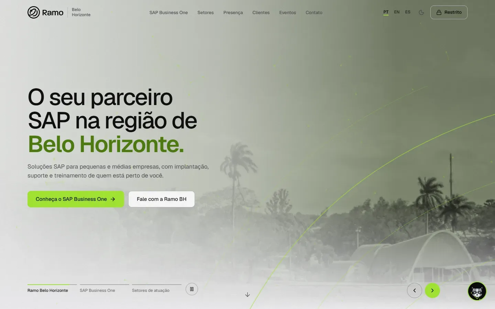
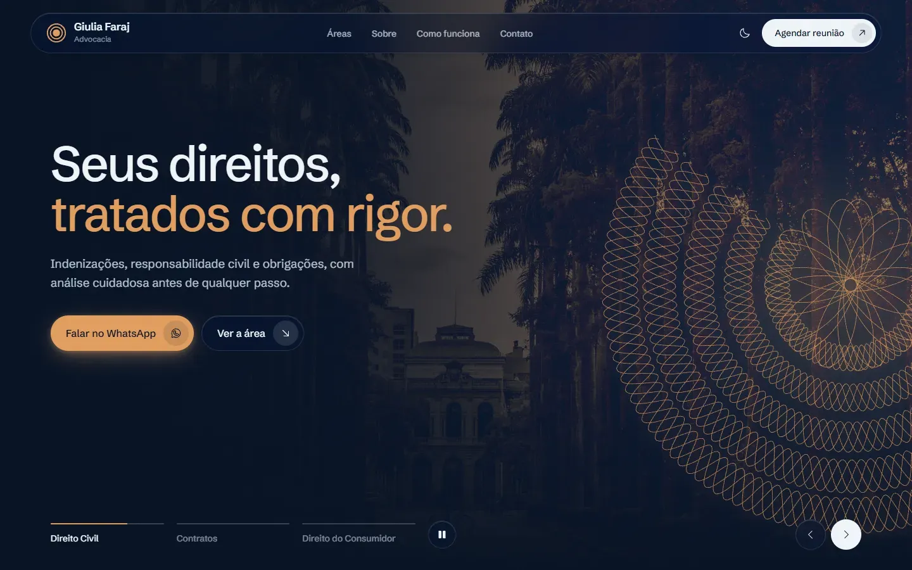
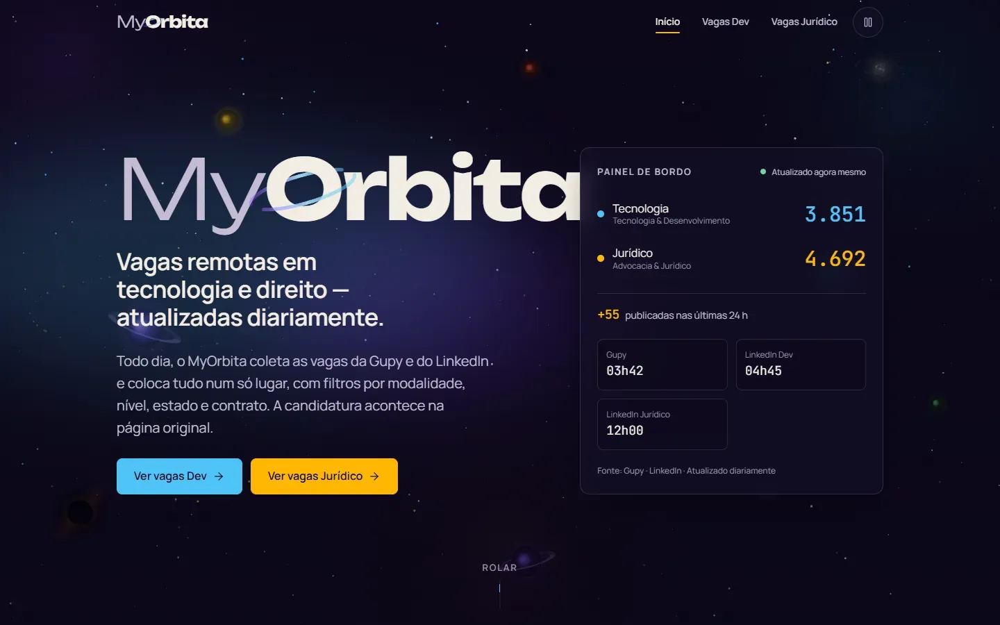
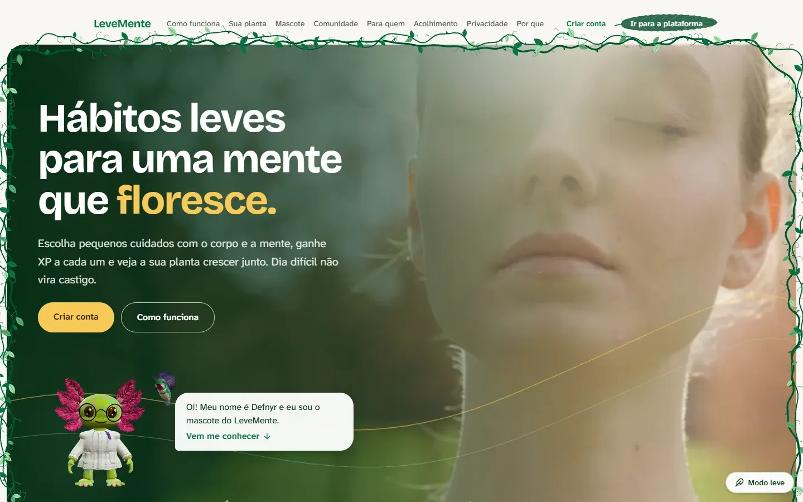
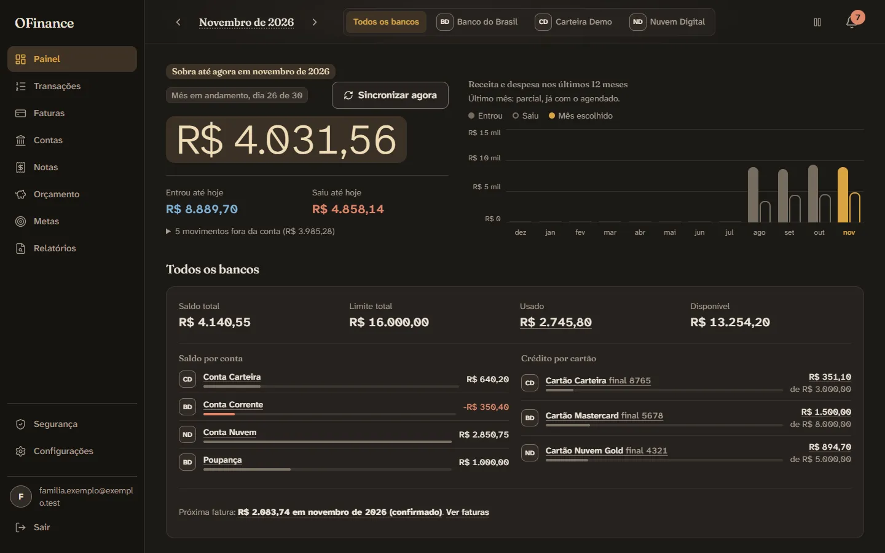
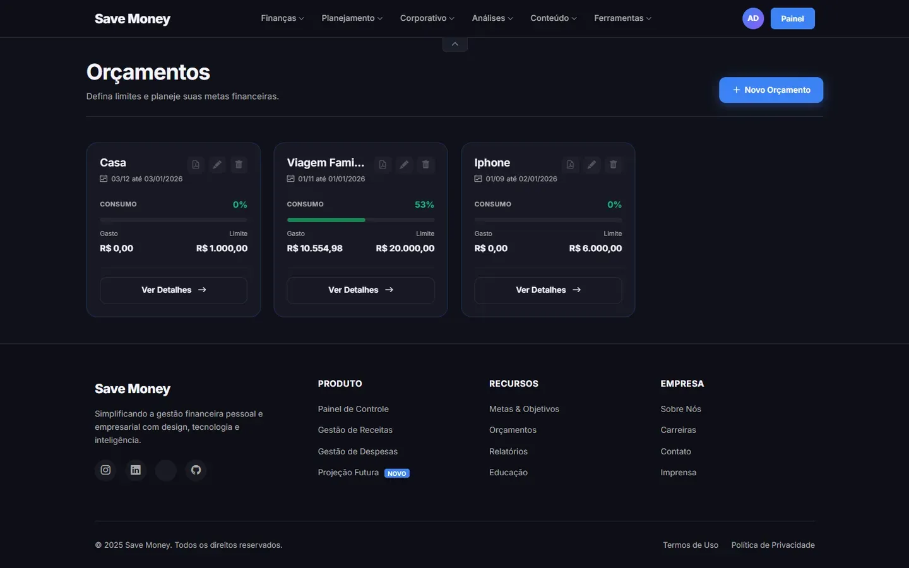
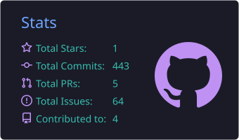
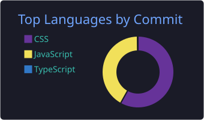

<!-- Selos (shields.io): o nome depois de logo= é o ícone do simpleicons.org; a cor vem logo antes de ?style -->

## Sobre mim

- 💼 **Autônomo:** sites, landing pages e plataformas web sob medida, do levantamento de requisitos à publicação.
- 🏢 **Estagiário de back-office na Ramo (BH):** SAP Business One, procedures em SQLScript (HANA), consultas em SQL e automação do sistema.
- 🎓 **Análise e Desenvolvimento de Sistemas na PUC Minas**, com conclusão prevista para jul/2027. Destaque de projeto no 1º semestre (Estúdio de Ideias) e no 2º (Save Money, Destaque do Eixo 2).
- 📚 **Alura:** carreira Desenvolvimento Back-End .NET, em andamento.
- 🤝 Projetos em equipe na faculdade e no hackathon da Ramo, onde representei o grupo junto à organização.
- 🌐 Os estudos de caso completos estão no [portfólio](https://maicontheodoro-dev.vercel.app).

## Tecnologias

<!-- Ícones (skillicons.dev): cada nome em ?i= vira um ícone, na ordem escrita -->

**Front-end**

**Back-end e APIs**

**Dados**

Também: SQL Server · SQL e SQLScript (SAP HANA) · **ERP:** SAP Business One

**Ferramentas e infraestrutura**

Também: Render · Playwright, Vitest e xUnit nos testes automatizados

## Projetos

<!-- Cada card é um print do projeto (assets/projetos/). Só tem link quando o site ou o código estão abertos. -->

### No ar

<table>
  <tr>
    <td width="50%" valign="top">
       
      <b>Ramo Ops</b> · plataforma do 1º Hackathon da Ramo 
      React · TypeScript · Django REST · PostgreSQL · <a href="https://ramoops.vercel.app">site</a>
    </td>
    <td width="50%" valign="top">
       
      <b>Giulia Faraj Advocacia</b> · site institucional para cliente 
      React 19 · Tailwind CSS 4 · GSAP · Lenis · <a href="https://giulia-faraj-adv.vercel.app">site</a>
    </td>
  </tr>
  <tr>
    <td width="50%" valign="top">
       
      <b>MyOrbita</b> · agregador de vagas atualizado todo dia por scrapers 
      Python · GitHub Actions · Firebase · React 19 · <a href="https://github.com/MaiconVts/MyOrbita">código</a> · <a href="https://my-orbita.vercel.app">site</a>
    </td>
    <td width="50%" valign="top">
       
      <b>LeveMente</b> · bem-estar e saúde mental, projeto em equipe da PUC Minas 
      C# (.NET 10) · ASP.NET Core · MongoDB Atlas · Next.js · <a href="https://levemente-web.onrender.com/">site</a> · código privado
    </td>
  </tr>
  <tr>
    <td width="50%" valign="top">
       
      <b>Estúdio de Ideias</b> · destaque de projeto do 1º semestre, já redesenhado 
      HTML · CSS · JavaScript · GSAP · Lenis · <a href="https://maiconvts.github.io/estudio-de-ideias/">site</a>
    </td>
    <td width="50%" valign="top">
       
      <b>OFinance</b> · controle financeiro familiar, com vários perfis e painel consolidado 
      Next.js · TypeScript · Supabase · Tailwind · <b>em produção e fase de testes</b> · dados de demonstração, código privado
    </td>
  </tr>
</table>

### Em refatoração

Projetos que estou reescrevendo antes de publicar. O código é privado.

<table>
  <tr>
    <td width="50%" valign="top">
       
      <b>Save Money</b> · gestão financeira pessoal e empresarial, <b>Destaque do Eixo 2 no 2º semestre</b> 
      C# · ASP.NET · SQL Server · JavaScript · em equipe · refatoração em andamento
    </td>
    <td width="50%" valign="top">
      <b>Estudos que também estou refatorando</b>
      <ul>
        <li><b>PokeApi</b>: API REST em Flask, feita com base no livro de Cory Althoff e sem IA (Python · Flask)</li>
        <li><b>Backoffice de loja</b>: demonstração de Bootstrap 5 com Sass</li>
        <li><b>Rede social de nicho</b>: demonstração de Tailwind CSS</li>
      </ul>
      Os prints entram quando cada um estiver publicado.
    </td>
  </tr>
</table>

Mais projetos e estudos de caso no [portfólio](https://maicontheodoro-dev.vercel.app).

## Estatísticas

<!-- Estes SVGs são gerados todos os dias pelo workflow .github/workflows/perfil.yml e ficam neste repositório, sem depender de API pública. -->

---

  ⚡ Fato curioso: larguei um curso de TI depois de um ano para recomeçar do zero o mesmo curso em uma nova faculdade.

